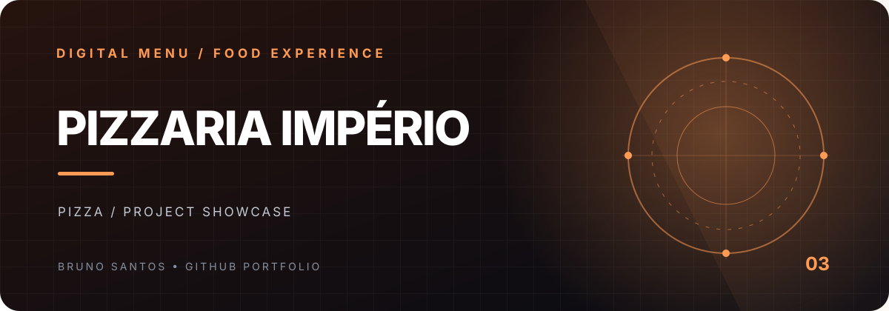

# Pizzaria Império
### Uma ideia de cardápio digital

Repositório reservado ao desenvolvimento de uma experiência digital para apresentação de produtos de uma pizzaria. A proposta é organizar o cardápio de forma visual, intuitiva e acessível.

---

## ✦ Objetivo
Criar uma interface onde clientes possam conhecer sabores, visualizar informações dos produtos e encontrar facilmente os canais de contato da pizzaria.

## Ideias para evolução
- Categorias de pizzas e acompanhamentos.
- Cards com fotos, descrição e preço.
- Layout responsivo para celular e computador.
- Resumo do pedido.
- Integração futura com WhatsApp ou sistema de pedidos.

## Tecnologias
As tecnologias ainda serão definidas conforme a implementação do projeto.

## Status
**Em planejamento.** Este repositório ainda não contém uma aplicação funcional. As funcionalidades acima representam objetivos de desenvolvimento.

Desenvolvido por **Bruno** · [GitHub](https://github.com/brunosg24)

